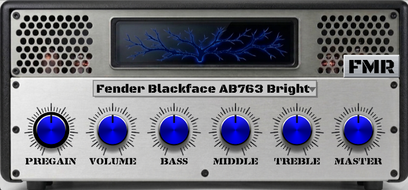

# Neural Preamp

**39 Amplifier Voices. One Plugin.**

From cleans to crushing high gain, Neural Preamp brings together 39 carefully crafted guitar preamp channels inspired by iconic tube amplifiers.

Powered by dedicated neural models, each channel captures the distinctive tonal character and dynamic response of its original amplifier.

But great tone is more than just gain and saturation. Using impulse response captures, each model features an EQ that faithfully reproduces the behaviour of the original amplifier's equalizer.

39 distinct amplifier voices. Authentic dynamics. Faithful tone shaping.

**Explore. Craft. Find. Enjoy your own sound!**

Distributed as a free **Windows VST3** plugin by [FMR Labs](https://github.com/FMR-Labs). Built using **iPlug2**.

<p align="center">
  
</p>

> **Note:** FMR Labs is an independent personal project and is not affiliated with FMR Audio.

> [!IMPORTANT]
> This plugin models **the preamp section only**. For a realistic guitar tone, place a **cabinet simulator / Impulse Response (IR) loader** right after Neural Preamp in your signal chain. Without it, the sound will be very harsh and fizzy, like plugging a hardware preamp straight into a mixing desk with no speaker cabinet.

---

## Features

* 39 preamp models selectable from a drop-down menu (list below)
* Controls: **PreGain**, **Volume**, **Bass**, **Middle**, **Treble**, **Master**
* Mono or stereo (`1-1`, `2-2`), independent processing per channel
* Input level LED (green / orange / red) and output level indicator
* Click-free amp switching (short mute fade)
* Runs at any host sample rate: the engine works at 48 kHz, with automatic resampling when the host runs at another rate. The resampler latency is reported to the host.
* Lightweight: small recurrent neural network per model, no allocation or lock on the audio thread

## Signal chain

```
Host (any fs, 1-2 ch)
 → [fs ≠ 48 kHz] resampling → 48 kHz
 → PreGain (×0.1 … ×10, i.e. -20 … +20 dB)
 → neural preamp model (driven by Volume)
 → Bass / Middle / Treble
 → Master
 → [fs ≠ 48 kHz] resampling → host fs
```

## Level indicators

| Indicator | Measured | Green | Orange | Red |
|---|---|---|---|---|
| Input LED | Level after PreGain | below -9 dB | below -3 dB | above |
| Output indicator | Level after Master | colour scale, dark blue (low) to near white (high) | | |

Input LED thresholds are relative to a 4.5 full scale.

## Preamp models

| Brand / model | Variants |
|---|---|
| Bogner Triple Giant | Clean, Brown, Sharp |
| Diezel VH4 | Channel 1, 2, 3, 4 |
| Dumble ODS | Clean, Overdrive |
| Fender | Bassman 5F6, Blackface AB763, Blackface AB763 Bright |
| Framus Cobra V1&2 | Clean, Crunch, Lead |
| HiWatt DR103 | Normal, Brilliant |
| Marshall | JCM600, JCM800, JMP1959 (Input 1, Input 2), JTM45 (Input 1, Input 2) |
| Mesa Dual Rectifier | Or. Clean, Or. Normal |
| Orange Rockerverb | Clean, Dirty |
| Peavey EVH5150 | Clean, Crunch, Lead |
| Revv | Channel 2 Green, Channel 2 Crunch, Channel 3 Purple, Channel 4 Red |
| Soldano SLO100OD | Clean, Crunch, Lead |
| Vox AC30C2 | Normal, Top Boost |

*All amplifier and brand names are trademarks of their respective owners. They are used for identification purposes only; FMR Labs is not affiliated with, endorsed or sponsored by any of them.*

---

## Installation (Windows)

> Binaries will be published on the **[Releases](../../releases)** page. Until then, there is nothing to download.

1. Download the latest `.zip` from the **[Releases](../../releases)** page. It contains the plugin, a `README_FMR_NeuralPreamp.txt` (installation, license, third-party notices) and the font license file.
2. Extract the `.vst3` file.
3. Copy it into your VST3 folder (usually `C:\Program Files\Common Files\VST3`).
4. Rescan plugins in your DAW.

---

## About this repository (source code notice)

This repository contains the **iPlug2 wrapper and UI** of Neural Preamp: plugin class, parameters, UI layout, resources and CMake project.

* **The DSP engine is closed source and not included.** `CMakeLists.txt` and `NeuralPreamp.cpp` reference it through `../FMR_Library/` (neural network inference, amp models and weights, EQ, resampler, pot curves, filters, and a custom UI control). **The project cannot be compiled from this repository alone.**
* **Fonts and images are not included** (the knob and background bitmaps, and the fonts embedded in the plugin). See [THIRD_PARTY.md](THIRD_PARTY.md) for their origin and licenses.
* It is published to share iPlug2 UI and parameter patterns, track issues and host documentation. Pre-compiled binaries will be distributed through GitHub Releases.

### Layout

| File | Role |
|---|---|
| `NeuralPreamp.h / .cpp` | Plugin class, parameters, UI, audio callback |
| `config.h` | iPlug2 plugin configuration (IDs, channels, UI size, resources) |
| `CMakeLists.txt` | iPlug2 CMake project (VST3 target) |
| `resources/` | Windows resources (`main.rc`, `resource.h`); fonts and images are not included |

### Building the wrapper structure (reference only)

Requires [iPlug2](https://github.com/iPlug2/iPlug2), CMake ≥ 3.14, a C++20 compiler, and the engine sources placed in `../FMR_Library/`:

```
cmake -B build -DIPLUG2_DIR=<path to iPlug2>
cmake --build build --config Release
```

---

## License

* **Source code in this repository** (iPlug2 UI and wrapper): [MIT License](LICENSE). The MIT license covers the code only. Fonts and images are not part of this repository and keep their own terms, see [THIRD_PARTY.md](THIRD_PARTY.md).
* **Compiled binaries (`.vst3`)**: **Freeware**. Free to use in both personal and commercial music productions. You may redistribute the original, unmodified archive, free of charge. Reverse engineering, decompiling, reselling, or redistributing modified binaries is prohibited.

*VST is a trademark of Steinberg Media Technologies GmbH.*
